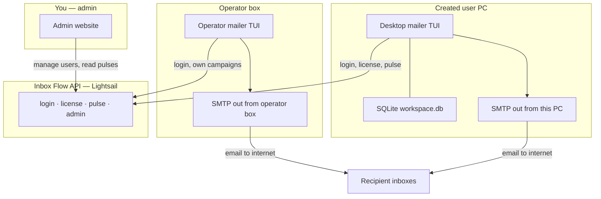
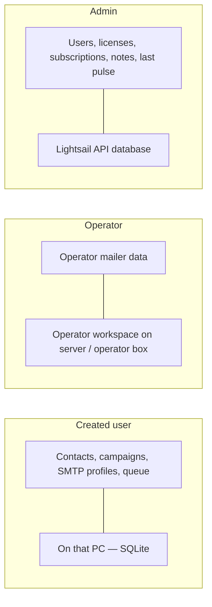
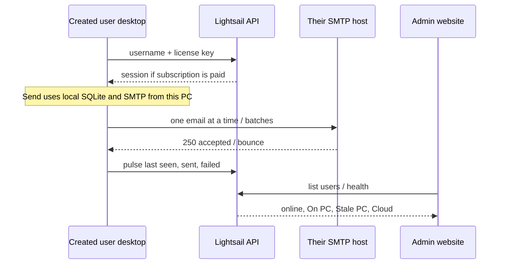
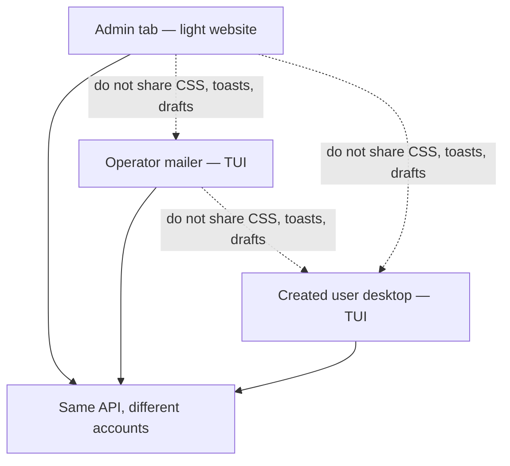

# Inbox Flow — How the three apps connect

Admin is a website on the server. The operator mailer and each created user’s desktop app talk to the **same API**. The desktop app does not talk to the admin page.

SMTP for created users leaves from **their PC**. There is no SSH hop and no “send through someone else’s RDP.”

## Overview

## Who stores what

Admin never sends tenant campaigns. It only creates users, renews time, and shows heartbeats.

## Login, send, pulse

Created users activate at `/bind-pc` (username + license → Bind PC). That stores their VPS IP. Open/click pixels go to **that EXE** (`/api/t` on the VPS). Lightsail is not in the pixel URL.

Pulse is a heartbeat about every 20–30 seconds while the desktop app is open.

| Admin label | Meaning |
|---|---|
| **Online** | Pulse within 2 minutes |
| **On PC** | Workspace is desktop SQLite, pulse within 30 minutes |
| **Stale PC** | Still a PC workspace, but no pulse for 30+ minutes |
| **Cloud** | Not the on-device SQLite workspace |

If admin is down, they can still send from an already-open desktop. If the **API** is down, they cannot log in or pulse; an in-progress local send can still finish against SQLite.

## What must not mix

Operator send totals are not added to tenant dashboards. Created-user SMTP never leaves from Lightsail.

## 24/7 runtime

Two clocks:

- **Lightsail API** should stay up (login, license, pulse, admin).
- **Created-user send** only runs while that PC and the desktop app are on.

Rules in the product:

1. Pulse never blocks SMTP. If the API is down, send continues; admin shows Stale PC.
2. SQLite uses WAL and one desktop instance per PC.
3. Admin, operator mailer, and tenant mailer keep separate shells (CSS, toasts, cache).
4. One SMTP failure is one recipient, not a crashed campaign.
5. Admin polling only while the tab is visible (45s).
6. Keep `ADMIN_UI_DEMO` on until Lightsail `/health` reports `features.pulse` and `features.resetLicense`.

### RDP / VPS send (leave the tab)

On Windows VPS the EXE runs a **local Node API**. Campaign send runs **in that process**, not in the browser tab.

You can switch tabs, minimize the browser, or disconnect the RDP *window* — mail keeps leaving from that VPS as long as:

- the VPS is still on
- Inbox Flow is not Quit (tray stays in the notification area)
- Windows sleep/hibernate is off

Closing the campaign tab does not stop SMTP. Pause / Resume / Cancel still go to the local API.
